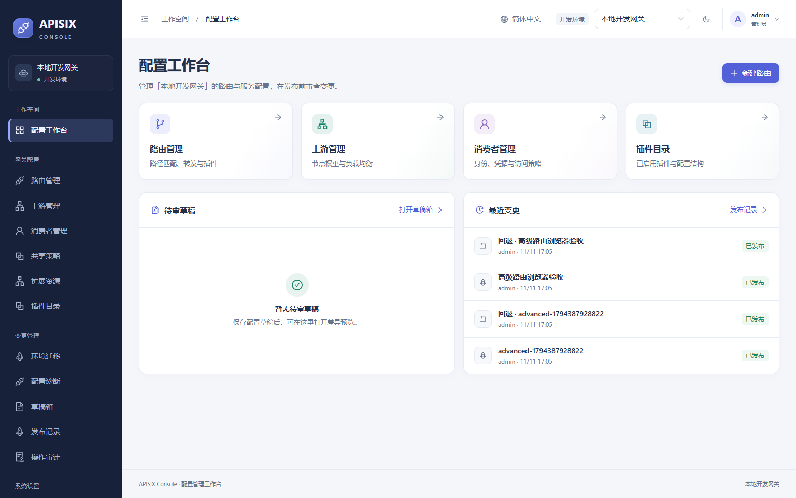
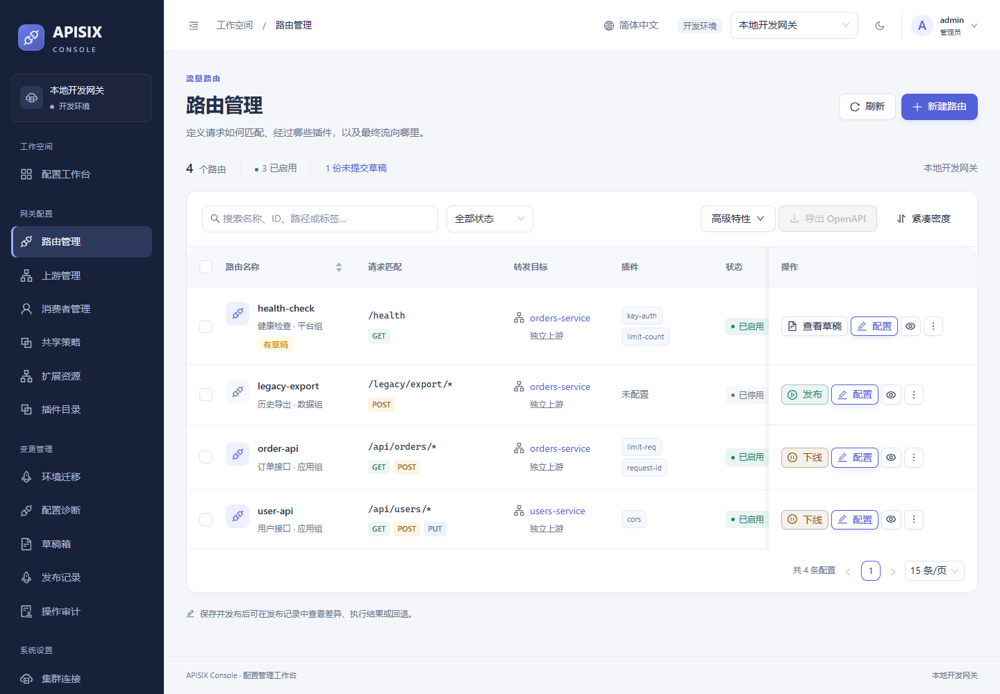
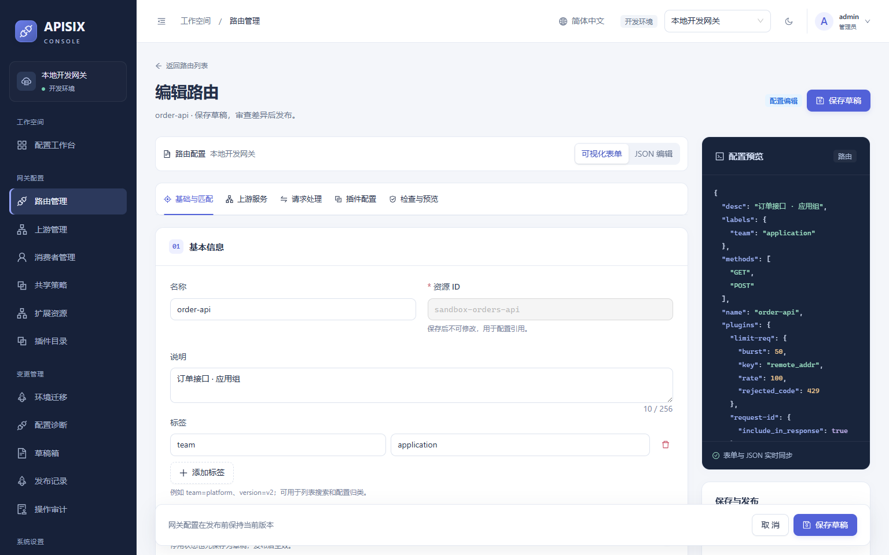
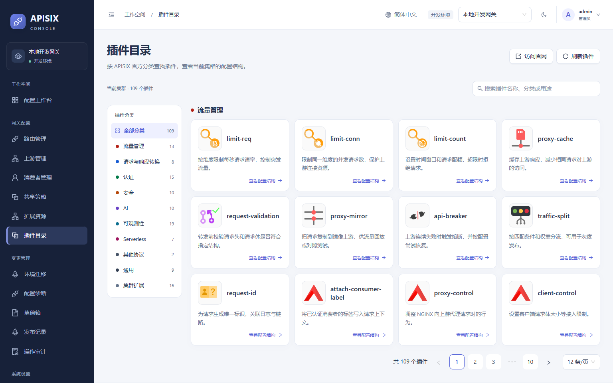
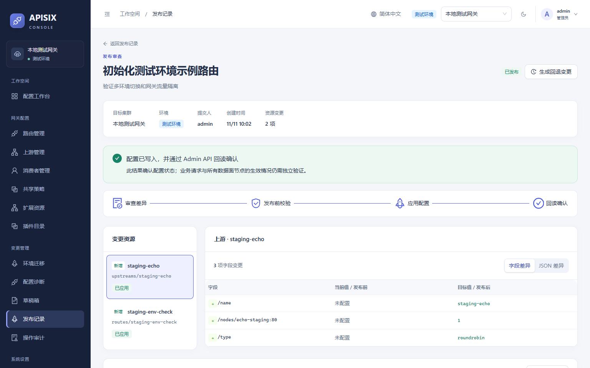
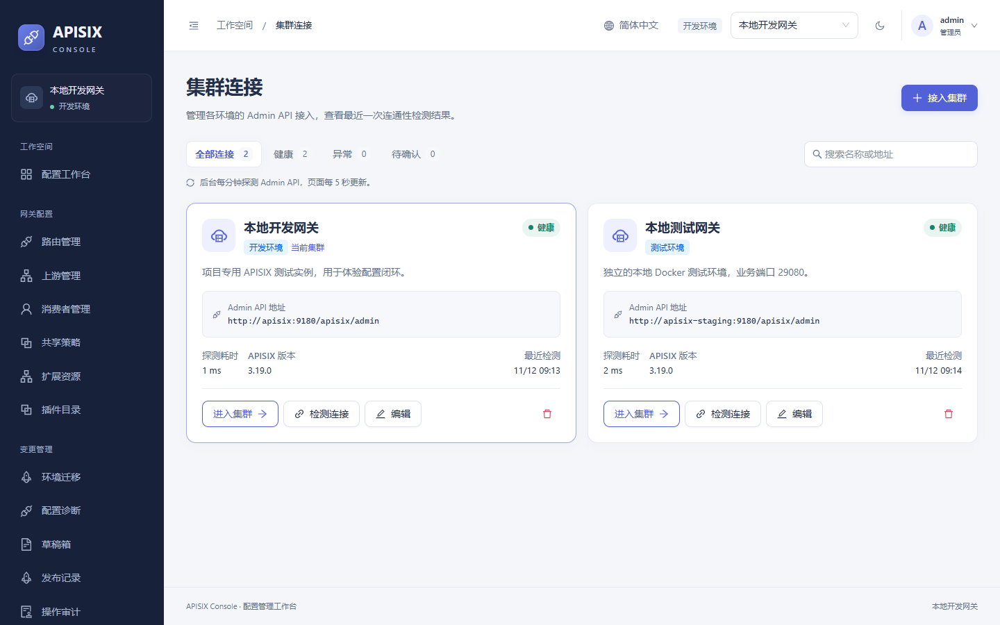
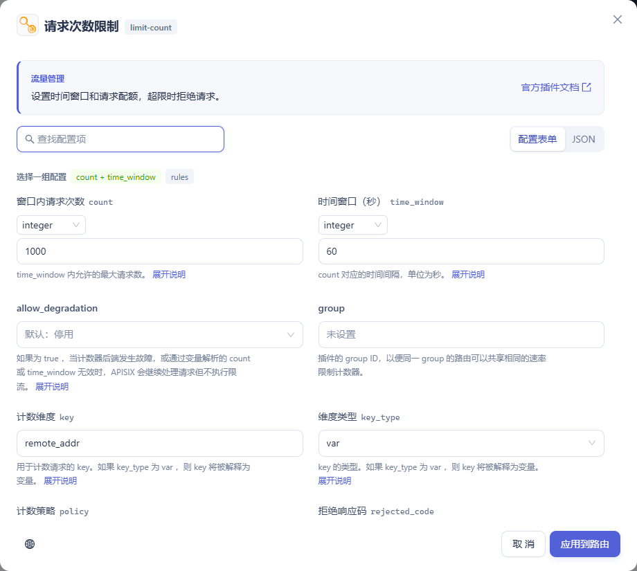

# APISIX Dashboard Next

面向 Apache APISIX 3.x 的独立配置控制台。运维人员可以在开发、预发和生产集群之间切换，直接发布路由、上游、插件和其他网关配置，并按发布记录回退。Dashboard 通过 Admin API 管理配置，业务流量直接经过 APISIX，数据面无需安装采集插件。

**V1.0.1** · 简体中文 / English · 浅色 / 深色主题 · React + TypeScript / Go / PostgreSQL

从 V1.0.0 升级后，可直接发布配置或交给发布人，在路由列表批量操作，按字段查找插件说明，并查看各集群的 Admin API 连通状态。服务编辑器支持搜索上游和配置主被动健康检查。[V1.0.1 完整版本说明与升级步骤](docs/releases/V1.0.1.md) · [GitHub Release](https://github.com/zjq-coder/apisix-dashborad-new/releases/tag/V1.0.1)

配套演示网关为 APISIX 3.19.0，路由编辑另有 3.14.1 的验收记录。各集群的可用资源和插件字段以该版本返回的 Schema 为准。

插件编辑器按当前集群的 Schema 展示可配置字段，提供中英文字段说明、配置项搜索、类型选择和官方示例。路由认证与消费者凭据各有独立表单。需要修改节点、SSL 或 Stream 配置的插件可在目录中查看设置位置。[逐插件实测、依赖和复测方式](docs/plugin-verification.md)

配套 Docker 网关在 3.19.0 基础镜像上包含多 worker 健康检查修复。新接手服务的 worker 会沿用已知的节点摘除状态。已有本地开发环境执行 `docker compose --profile gateway up -d --build --no-deps apisix` 即可更新网关。[测试与部署范围](docs/operations-guide.md#双节点故障摘除与恢复实测)

[部署方式](#部署方式) · [主要功能](#主要功能) · [界面截图](#界面截图) · [开发与测试](#开发与测试)

## 部署方式

需要 Docker Engine 或 Docker Desktop，以及 Docker Compose v2。Dashboard 镜像在构建时编译 Go 服务和前端，最终由同一容器提供网页与 API。仅在运行示例数据或前端开发脚本时需要主机安装 Node.js 24+。

### 1. 获取 V1.0.1 并初始化

~~~sh
git clone --branch V1.0.1 https://github.com/zjq-coder/apisix-dashborad-new.git
cd apisix-dashborad-new
~~~

在项目根目录按系统执行一条命令。初始化会生成独立的登录密码、数据库密码和加密密钥；再次执行会保留已有 `.env`。

| 系统 | 初始化命令 |
| --- | --- |
| Windows PowerShell | `.\scripts\init-dev.ps1` |
| Linux / macOS（需要 OpenSSL） | `sh scripts/init-dev.sh` |

### 2A. 接入已有 APISIX 集群

~~~sh
docker compose up -d --build
docker compose ps
~~~

1. 打开 [Dashboard](http://127.0.0.1:18080)，使用项目根目录 `.env` 中的 `DASHBOARD_USERNAME` 和 `DASHBOARD_PASSWORD` 登录。浏览器访问 [/healthz](http://127.0.0.1:18080/healthz) 可检查服务与数据库连接。
2. 在「集群连接」添加环境，填写 Admin API 地址和对应的 Admin Key。地址必须能从 **Dashboard 容器**访问。例如，多个控制面节点共同管理同一套配置时，可填内网负载均衡地址 `https://apisix-admin.example.internal:9180`，由负载均衡转发到提供 Admin API 的节点。每套独立配置建立一条集群连接。
3. 执行连接检测，在顶栏选中该环境，打开「路由管理」核对现有路由。首次接入可将连接设为只读，先核对地址、版本和资源，再按需要开放发布权限。

### 2B. 在本机启动演示网关

~~~sh
docker compose --profile gateway up -d --build
node scripts/seed-sandbox.mjs
~~~

此方式同时启动 Dashboard、PostgreSQL、APISIX、etcd 和 nginx 示例上游。初始化脚本通过草稿和发布接口补齐 2 个示例上游、4 条路由，跳过已有的同 ID 资源。登录后选择「本地开发网关」，打开 [订单示例接口](http://127.0.0.1:19080/api/orders/hello)，成功时响应包含 `"service":"dashboard-sandbox"`。

| 访问位置 | 默认地址 | 用途 |
| --- | --- | --- |
| 主机浏览器 | `http://127.0.0.1:18080` | Dashboard |
| 主机调用方 | `http://127.0.0.1:19080` | 演示网关业务入口 |
| Dashboard 容器 | `http://apisix:9180` | 配套开发网关的 Admin API |
| 主机调试工具 | `http://127.0.0.1:19180/apisix/admin` | 开发网关 Admin API，使用 `APISIX_ADMIN_KEY` |
| 主机数据库客户端 | `127.0.0.1:15432` | PostgreSQL，默认数据库与用户均为 `dashboard` |

可选：启动第二个演示环境，验证环境切换

先启动上面的开发环境，再在项目根目录执行以下命令。第二套 APISIX 使用独立的 etcd 数据卷和 Admin Key。

~~~sh
node -e "const fs=require('node:fs'); const file='.local/staging.env'; fs.mkdirSync('.local',{recursive:true}); if(!fs.existsSync(file)) fs.writeFileSync(file,'APISIX_ADMIN_KEY='+require('node:crypto').randomBytes(32).toString('hex')+'\n',{flag:'wx',mode:0o600})"
docker compose -f compose.staging.yaml up -d --build --wait
node scripts/seed-staging.mjs
~~~

在顶栏切换到「本地测试网关」即可看到 `staging-env-check`。打开 [预发示例接口](http://127.0.0.1:29080/__env/staging) 验证。单独停止此环境使用 `docker compose -f compose.staging.yaml stop`。

### 升级、持久化与生产接入

- **升级与停止**。更新到选定版本后，再运行部署时的 `docker compose up -d --build`；带演示网关时加上 `--profile gateway`。停止并保留数据使用 `docker compose --profile gateway stop`。从早期流量图版本升级的环境可查阅[迁移说明](docs/operations-guide.md#从带流量图的版本升级)。
- **数据库与密钥**。PostgreSQL 16 的命名卷 `dashboard-db` 保存账号、集群连接、草稿、发布和审计。备份 PostgreSQL 时同步保管 `DASHBOARD_ENCRYPTION_KEY`，恢复时使用原密钥解密已有记录。APISIX 自身的配置随网关 etcd 单独备份。
- **HTTPS 与会话**。默认端口只绑定主机回环地址。对外提供 Dashboard 时，在同一主机的反向代理终止 TLS，转发到 `127.0.0.1:18080`，保留原始 Host，通过 HTTPS 登录；在 `.env` 中设置 `SECURE_COOKIE=true` 后执行 `docker compose up -d dashboard`。Admin API 仅允许可信管理网络访问。
- **配置项**。见 [.env.example](.env.example)。`DASHBOARD_ENCRYPTION_KEY` 需要 64 位十六进制字符；`APISIX_IMAGE` 可指定演示网关镜像。首次启动用初始化脚本即可生成 Compose 所需凭据。

## 主要功能

在「路由管理」的操作列可以发布或下线路由、继续配置和查看已有草稿。眼睛按钮打开当前网关的脱敏配置，「更多」提供复制和删除。选中多条路由后可以导出 OpenAPI（JSON / YAML）或确认后批量删除。「高级特性」提供共享插件模板、JSON 数据编辑器及 OpenAPI 导入入口。详见[路由列表操作与验收](docs/route-list-actions.md)。

| 功能 | 在界面中可以做什么 |
| --- | --- |
| 多环境与权限 | 接入、编辑、切换和删除集群连接，按名称、地址或健康状态筛选，查看最近探测时间、耗时及错误原因。支持只读接入和按集群授权。 |
| 路由与上游 | 通过表单或 JSON 设置路径、域名、方法和嵌套条件；配置请求改写、重定向、服务引用、节点权重、负载均衡、重试和健康检查。 |
| 服务配置 | 在「扩展资源 → 服务」设置域名和服务级插件，按名称或 ID 搜索并绑定当前集群的上游，也可直接配置节点、连接池和健康检查。[服务配置指南](docs/operations-guide.md#配置服务并选择上游) |
| 插件与共享配置 | 按官方分类浏览集群已启用的插件，按 Schema 编辑。一条路由可引用一份包含多个插件的 Plugin Config；界面逐项显示继承、路由覆盖与停用状态。 |
| 消费者与凭据 | 维护消费者、消费者组与独立 Credential；在消费者页面配置 API Key、Basic、JWT 等凭据，在路由启用对应插件。已保存的敏感值脱敏显示，支持轮换。 |
| 草稿、差异、发布与回退 | 编辑时可校验配置，比较字段或 JSON 差异。直接发布会检查基线、Schema 和引用并回读；支持按记录回退或选择暂存草稿。 |
| 共享策略与扩展资源 | 管理全局规则、插件元数据、Service、Stream Route、Proto 和 Secret 管理器，查看资源依赖。TLS 证书支持查询和目标环境引用。 |
| 迁移与配置诊断 | 连同依赖导出脱敏配置包，映射目标资源 ID、域名和节点，解决冲突后一次发布到目标集群。输入请求方法、域名、路径，可离线分析候选路由和配置引用。 |
| 操作审计 | 按集群查看配置操作与发布执行记录。管理端持有网关 Admin Key，浏览器使用 Dashboard 会话。 |

**第一次发布**可以从演示环境的 `order-api` 开始。修改路由说明后点击「保存并发布」，执行成功后回到列表。「发布记录」保留逐项差异和回读结果。「回退已应用配置」可以恢复之前的版本。批量发布遇到执行错误会停止后续操作，详情会列出已应用、失败和跳过的资源。

- 同时具备编辑和发布权限，可直接发布。生产环境需要输入目标集群名称；删除、上下线和批量删除会提示影响范围。
- 只有编辑权限的账号点击「提交变更」，发布人在「发布记录」中确认即可执行。只读账号和只读集群不能写入。
- 路由、上游和消费者编辑器保留可选的「保存草稿」，用于跨资源分次编辑。直接发布不会新增草稿记录。

### 集群连接健康

后台约每分钟携带已保存的管理密钥读取一次每个集群的 Admin API 插件列表，单次超时 5 秒。关闭页面后探测继续。打开「集群连接」时，页面每 5 秒刷新已保存的结果。绿色「健康」表示 Dashboard 最近成功访问该管理地址。超过两分钟未收到新结果时显示「检测已过期」。需要检查路由与上游的读取权限时，可点卡片上的「检测连接」。这两种检测均只访问管理面。

管理员可以用卡片右下角的删除按钮解除接入。确认后会停止后续探测，清除保存的管理密钥和集群授权。网关上的路由和上游继续运行，历史发布与操作审计保留。若有发布正在进行，需等发布结束再移除。

[查看集群连接界面截图](docs/screenshots/cluster-connections.png)

## 界面截图

以下截图取自本地开发和预发演示环境。点击图片可查看原图。

| 路由管理 · 已发布的路由、匹配规则与启停状态 | 路由编辑 · 分区表单与实时配置预览 |
| --- | --- |
|  |  |
| **插件目录 · 按类别浏览集群启用的插件** | **发布详情 · 查看目标环境、执行结果与回退入口** |
|  |  |
| **集群连接 · 管理地址及最近一次健康探测** | **插件配置 · 按字段查找说明并编辑参数** |
|  |  |

## 开发与测试

在仓库根目录执行。开发服务器默认监听 `http://127.0.0.1:5173`，将 `/api` 转发至本机 Dashboard 端口 18080。

~~~sh
npm ci
npm run dev
~~~

| 检查 | 命令与前置条件 |
| --- | --- |
| 前端单元测试、类型、构建、格式 | `npm run test:web`、`npm run typecheck`、`npm run build`、`npm run format:check` |
| Go 后端 | 在 `server/` 运行 `go test -race ./...` 和 `go vet ./...` |
| 集群连接 | 初始化本地演示网关后运行 `node scripts/test-cluster-connections.mjs`，通过临时只读转发节点验证断连、恢复、权限和删除后停探。浏览器回归运行 `npm run test:e2e -- cluster-connections.spec.ts`。 |
| 直接发布与回退 | [隔离 Docker 集成测试](docs/route-list-actions.md#直接发布的集成测试)覆盖全部 12 类可写资源，包含 HTTP 和 Stream 数据面验证。 |
| 路由与真实代理 | 启动并初始化演示网关后运行 `npm run test:integration`、`npm run test:routes` |
| 消费者与插件 | `npm run test:consumers`、`npm run test:consumer-plugins`。后者还会使用 Docker 启动独立的 LDAP 和 Wolf 协议测试服务。 |
| 双环境、权限与浏览器 | 启动并初始化两个演示环境，依次执行 `node scripts/test-operations.mjs`、`node scripts/test-access.mjs`、`npm run test:e2e`。Playwright 默认使用 Edge，可通过 `PLAYWRIGHT_CHANNEL` 切换到已安装的 Chrome。 |

涉及网关写入的验收套件请在配套本地环境**串行**运行。项目代码分别位于 [web/src](web/src) 和 [server](server)。[deploy](deploy) 包含示例网关配置，[scripts](scripts) 和 [tests](tests) 包含初始化及验收工具。

## 进一步阅读

- [生产配置运维指南](docs/operations-guide.md) — 共享插件、扩展资源、迁移冲突、兼容范围与验收记录
- [架构与发布语义](docs/architecture.md) · [管理接口](docs/api.md)
- [账号权限与审计](docs/access-control.md) · [消费者认证配置与验证](docs/consumer-plugin-verification.md) · [高级路由实现与验收](docs/route-editor-verification.md)
- [插件图标来源](web/public/plugin-icons/SOURCES.txt) · [APISIX 官方文档](https://apisix.apache.org/docs/apisix/)
