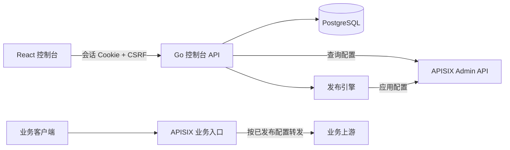
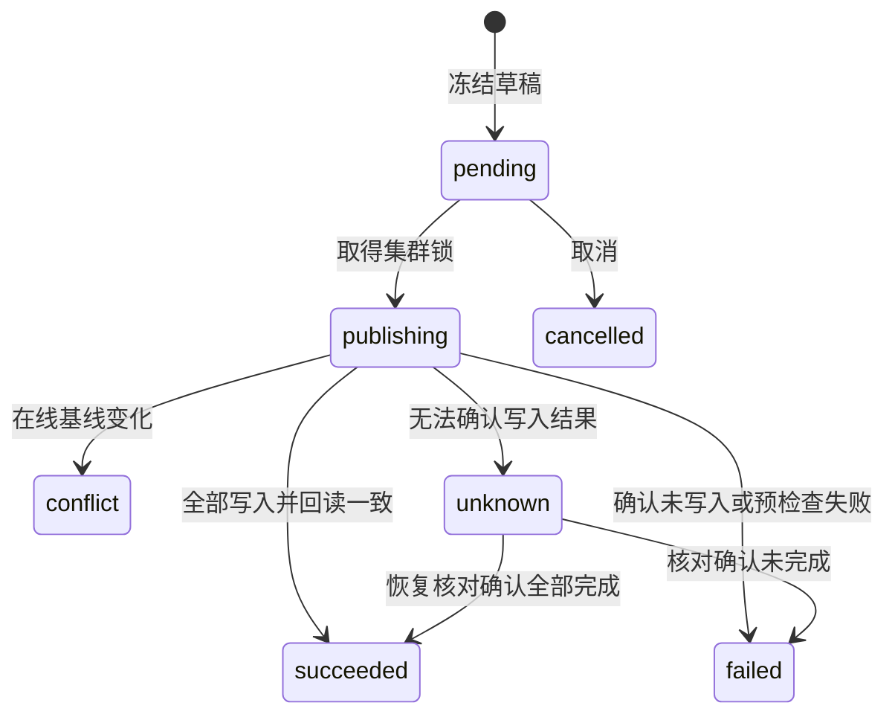

# 架构与发布语义

## 组件边界

Go 服务同时提供构建后的 SPA 和 `/api/v1`。前端部署无外部 CDN 依赖，Monaco worker 本地打包。数据库存管理数据；APISIX 是已发布配置的真实来源，控制台不直连 etcd，也不自动同步覆盖在线配置。

配置工作台的草稿与变更摘要来自 PostgreSQL。打开资源管理页面、校验或发布配置时，控制台访问所选集群的 Admin API。业务客户端直接访问 APISIX，由网关执行配置的插件并转发至上游。该路径独立于 Dashboard 的进程和存储。

## 存储模型

| 表 | 保存内容 |
| --- | --- |
| clusters | 连接地址、环境、加密 Admin Key、探测状态 |
| console_accounts / console_grants | bcrypt 账号哈希、角色、启停状态和授权版本；按账号与集群保存操作权限 |
| sessions | 会话令牌 SHA-256 与过期时间；不保存明文令牌 |
| drafts | 不可变目标、动作、编辑基线哈希、前后配置密文、草稿 revision |
| changesets | 发布说明、状态、目标集群、发起人、rollback_of |
| operations | 执行顺序、状态、基线、加密快照与实际回读值、错误摘要 |
| audit_events | 操作人、操作、对象和简短说明；不记录配置正文 |

配置快照和管理凭据采用 AES-256-GCM，应用密钥由环境变量提供。草稿返回敏感字段占位符 `${dashboard:keep-secret}`。初次编辑时占位符从在线基线恢复，重复编辑草稿时从最新草稿恢复，防止新设置的密钥被旧值替换。

同资源只允许一个未提交草稿；草稿 revision 使用条件更新检测并发。发布变更创建时以事务锁定草稿并冻结内容。新的编辑可以生成新的草稿，其发布仍受在线基线检查约束。

## 校验层次

1. 控制台校验请求类型、资源 ID、JSON 对象与编辑 revision。
2. 读取目标在线配置并比较规范化配置哈希；只忽略 APISIX 的 `id/create_time/update_time` 元数据。
3. 调用目标 APISIX 的 `/schema/validate/routes` 或 `/schema/validate/upstreams`。
4. 路由插件额外读取已启用插件列表与各插件 Schema，在服务端做 JSON Schema 校验；默认值仅填到校验副本，草稿原值不改写。禁止外部 `$ref` 加载，错误只显示字段位置和约束名称。
5. 将本次路由/上游操作应用到内存视图，验证 `upstream_id` 和 `service_id`；删除上游前还检查服务引用。
6. 正式写入仍可能因 Lua 自定义检查、插件特殊引用等失败，执行记录保留该结果。

不能只依赖实体 Schema 校验插件参数：APISIX 3.14 的 [schema_validate 实现](https://github.com/apache/apisix/blob/3.14.1/apisix/admin/init.lua) 仅调用实体 schema 检查；[官方 Admin API 文档](https://apisix.apache.org/docs/apisix/3.14/admin-api/#schema-validation) 也说明通过 Schema 不代表实体写入一定成功。本项目通过真实无效插件参数测试验证了额外校验。

## 执行顺序和状态

发布按目标集群使用 PostgreSQL advisory lock 串行执行。集群编辑与发布共享同一锁。顺序为：创建/更新上游 → 创建/更新路由 → 删除路由 → 删除上游。最多 50 个草稿合并一次发布。

每次远程写入前先持久化 `applying`。即使请求超时，也立即回读；写入成功但应答丢失时可以确认 `applied`。不能回读或回读与目标不一致则为 `unknown`，不会盲目重试，也不继续后续操作。

进程重启后可在详情页「核对执行结果」。核对只读取已执行但结果未明的操作，不自动续跑剩余操作。已应用的部分可单独生成回退变更。APISIX 自动填充的已知资源默认值参与回读等价比较；未知差异按待核对处理。

## 回退

回退是新的、可审查的变更。只反转原发布中 `applied` 的操作：新增变删除，删除变新增，修改恢复旧快照。回退的基线是原发布实际回读的配置，因此后续外部编辑会触发冲突。数据库保留原发布和回退的关联。

回退请求对同一原发布复用同一回退变更，避免双击生成重复任务。已取消或失败的回退若需要以新的在线基线重做，应创建新的配置草稿，不会把历史任务直接重置后重发。

## 后续扩展点

`Gateway` 接口可增加版本适配器；资源编辑器可扩展服务、消费者和证书；认证层可替换为 OIDC + RBAC；发布引擎可接入审批、单写者约束和外部任务队列。当前模块化单体避免第一阶段引入多服务运维依赖。

权限在 Dashboard 服务端逐请求执行。后台发布的终态和执行人审计在同一 PostgreSQL 事务提交，账号授权变更、撤销会话和授权审计也在同一事务。详情见[权限与审计](access-control.md)。
