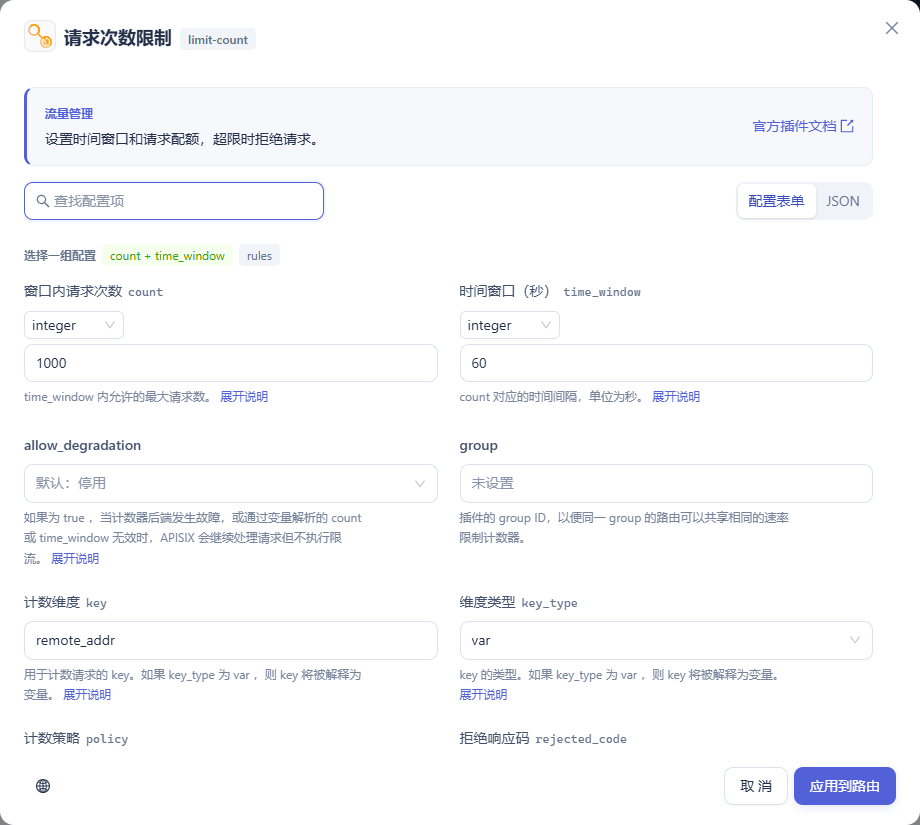

# APISIX 插件配置与验证

本次使用本地 APISIX 3.19.0。按官网目录逐项核对 105 个条目，其中 104 个条目观察到了下表所列的运行时效果。官网的 `serverless` 对应两个独立执行插件。另有 16 个当前集群扩展，其中 16 个观察到了实际效果。[Apache APISIX 插件目录](https://apisix.apache.org/zh/plugins/)

## 配置操作

在「路由管理 → 配置 → 插件配置 → 添加插件」中可按类别筛选和搜索。打开插件后可以查找字段、展开官方说明、配置必填值和可选项。数值与网关变量可显式切换类型，复杂分支也可在 JSON 模式编辑。路由上的认证策略与消费者上的凭据分开配置。切换语言会同时切换字段帮助、官方示例和文档链接。

官网目录以外，部分集群插件也有 APISIX 版本文档。例如 `ldap-auth-advanced` 归在「集群扩展」，仍可查看官方说明与示例。字段帮助随控制台部署；维护者可运行 `python scripts/sync-plugin-guide.py --refresh` 更新文档。

## 测试环境与判定

- 开发网关的源路由为 `sandbox-orders-api`，路径为 `/api/orders/*`。测试使用唯一主机或 URI 创建临时路由，普通 HTTP 场景复用订单上游。每项常规路由用例均经 Dashboard 校验正确和错误配置、发布并从 Admin API 回读。仅验证 Schema 的步骤不计入运行时效果。
- 需要模型、身份服务、遥测、云函数、WAF、gRPC 或 Dubbo 的插件使用本地协议测试端。接收请求、回调、返回数据或协议帧均按用例断言。云厂商真实账号的鉴权、存储、计费和生产质量未在本次范围内验证。浏览器认证跳转的覆盖深度按下表逐项列出。
- Kafka、Redis、OpenLDAP 与 Go Plugin Runner 实际运行于本地容器。节点级、Stream、SSL 和插件元数据用例使用独立的网关与 etcd，避免覆盖现有集群设置。测试后检查临时资源清理结果，以及源订单路由配置哈希。
- 状态码列为开发网关脚本记录的响应顺序。WebSocket、TLS、TCP、UDP、异步投递及独立网关断言以“实际观察”列为准。每一行的结论限于列出的行为，同一插件的每种提供商、选项组合和部署环境均需按实际配置验收。

## 流量管理

| 插件 | 运行环境 | HTTP | 实际观察 |
| --- | --- | --- | --- |
| `limit-req` | 开发网关 | 200 → 429 | 连续请求超过速率阈值 |
| `limit-conn` | 开发网关 | 429 → 429 → 200 | 并发时仅一个慢请求获准 |
| `limit-count` | 开发网关 | 200 → 429 | 第二次请求超过计数配额 |
| `proxy-cache` | 开发网关 | 200 → 200 | 相同订单请求从 MISS 变为 HIT |
| `request-validation` | 开发网关 | 422 → 200 | 缺少 order 返回 422，合法订单到达上游 |
| `proxy-mirror` | 开发网关 | 200 | 原请求到订单，镜像端实际收到副本 |
| `api-breaker` | 开发网关 | 500 → 503 | 首次上游返回 500，后续请求触发熔断并返回指定正文 |
| `traffic-split` | 开发网关 | 200 → 200 | 只有带 canary 标记的请求进入第二上游 |
| `request-id` | 开发网关 | 200 → 200 | 两个业务请求得到不同请求标识 |
| `attach-consumer-label` | 开发网关 | 200 | 原订单上游收到已认证消费者的 team 标签 |
| `proxy-control` | 开发网关 | — | 客户端尚未发送最后一段请求体时，上游已读到第一段 |
| `client-control` | 开发网关 | 413 → 200 | 超过配置的请求体大小被拒绝 |
| `traffic-label` | 开发网关 | 200 | 订单上游实际收到规则写入的标签头 |

## 请求与响应转换

| 插件 | 运行环境 | HTTP | 实际观察 |
| --- | --- | --- | --- |
| `response-rewrite` | 开发网关 | 202 | 订单响应状态、正文和头同步改变 |
| `proxy-rewrite` | 开发网关 | 200 | 原订单上游实际收到新方法、路径和请求头 |
| `grpc-transcode` | 开发网关 | 200 | HTTP JSON 请求经 gRPC 转码，解码返回的 protobuf 字段 |
| `grpc-web` | 开发网关 | 200 | 浏览器 gRPC-Web 帧到达 HTTP/2 服务，客户端收到 protobuf 消息及成功 trailer |
| `body-transformer` | 开发网关 | 200 | 响应模板读到真实订单上游的 service |
| `degraphql` | 开发网关 | 200 | 在上游观察到插件生成的 GraphQL 查询 |
| `exit-transformer` | 独立网关 | — | 把缺少凭据的 401 改为配置的 409 |
| `fault-injection` | 开发网关 | 418 | 按配置直接返回故障码及正文 |
| `gm` | 本轮跳过（缺少依赖） | — | 已实测当前网关未链接 Tongsuo，国密握手需要 Tongsuo 网关与国密双证书 |
| `mocking` | 开发网关 | 201 | 直接返回设定的模拟订单 |

## 认证

| 插件 | 运行环境 | HTTP | 实际观察 |
| --- | --- | --- | --- |
| `key-auth` | 开发网关 | 401 → 401 → 200 | 订单路由拒绝缺失和无效凭据，正确消费者可访问原订单上游 |
| `jwt-auth` | 开发网关 | 401 → 401 → 200 | 订单路由拒绝缺失和无效凭据，正确消费者可访问原订单上游 |
| `basic-auth` | 开发网关 | 401 → 401 → 200 | 订单路由拒绝缺失和无效凭据，正确消费者可访问原订单上游 |
| `authz-keycloak` | 开发网关 | 401 → 403 → 200 | 缺令牌 401，本地 UMA 拒绝时 403、允许时订单上游返回 200 |
| `authz-casdoor` | 开发网关 | 302 | 无会话时重定向到配置的身份服务 |
| `wolf-rbac` | 开发网关 | 401 → 403 → 200 | 订单路由拒绝缺失和无效凭据，正确消费者可访问原订单上游 |
| `openid-connect` | 开发网关 | 401 → 401 → 200 | 缺少或无效 Bearer 令牌返回 401，introspection 确认的令牌可访问订单 |
| `cas-auth` | 开发网关 | 302 | 无 CAS 会话时重定向到本地 IdP |
| `hmac-auth` | 开发网关 | 401 → 401 → 200 | 订单路由拒绝缺失和无效凭据，正确消费者可访问原订单上游 |
| `authz-casbin` | 开发网关 | 403 → 200 | 同一订单路径按请求用户匹配策略 |
| `ldap-auth` | 开发网关 | 401 → 401 → 200 | 订单路由拒绝缺失和无效凭据，正确消费者可访问原订单上游 |
| `jwe-decrypt` | 开发网关 | 403 → 400 → 200 | 订单路由拒绝缺失和无效凭据，正确消费者可访问原订单上游 |
| `multi-auth` | 开发网关 | 401 → 200 → 200 | 两种不同凭据均能访问订单，缺失凭据返回 401 |
| `opa` | 开发网关 | 418 | 本地 OPA 协议返回自定义拒绝码 |
| `forward-auth` | 开发网关 | 403 → 200 | 本地认证服务拒绝时返回 403，指定请求头转发并获准后订单返回 200 |

## 安全

| 插件 | 运行环境 | HTTP | 实际观察 |
| --- | --- | --- | --- |
| `cors` | 开发网关 | 200 | 允许来源收到指定 CORS 响应头 |
| `uri-blocker` | 开发网关 | 451 → 200 | 只拦截匹配的订单子路径 |
| `ip-restriction` | 开发网关 | 403 | 非白名单地址被拒绝并返回配置的提示 |
| `ua-restriction` | 开发网关 | 403 → 200 | 拒绝匹配 UA，其他 UA 访问订单成功 |
| `referer-restriction` | 开发网关 | 403 → 200 | 拒绝和允许来源分别命中规则 |
| `consumer-restriction` | 开发网关 | 403 | 已知消费者命中拒绝规则返回 403 |
| `csrf` | 开发网关 | 200 → 401 | 首次 GET 设置 CSRF cookie，未带令牌的 POST 被拒绝 |
| `chaitin-waf` | 独立网关 | — | 缺少元数据有诊断信息；本地 T1K 决策放行订单、拦截返回 403，观察模式仍放行并标注决策 |
| `oas-validator` | 开发网关 | 422 → 200 | OpenAPI 必填查询参数缺失和合法时结果不同 |
| `ocsp-stapling` | 独立网关 | — | 客户端验证证书链，并在 TLS 握手中收到与测试 CA 签名结果完全相同的 OCSP 响应 |
| `public-api` | 开发网关 | 404 | 公开 API 路由拒绝转发不存在的插件接口 |

## AI

| 插件 | 运行环境 | HTTP | 实际观察 |
| --- | --- | --- | --- |
| `ai-proxy` | 开发网关 | 200 | 请求抵达本地模型协议端，客户端收到 completion |
| `ai-proxy-multi` | 开发网关 | 200 | 请求抵达本地模型协议端，客户端收到 completion |
| `ai-request-rewrite` | 开发网关 | 200 | 本地模型返回的内容替换发往上游的请求正文 |
| `ai-rate-limiting` | 开发网关 | 200 → 429 | 模型响应的 token 使用量触发后续限额 |
| `ai-prompt-decorator` | 开发网关 | 200 | 模型协议端收到追加的 system 消息 |
| `ai-prompt-template` | 开发网关 | 400 → 200 | 只接受已配置模板，模型端收到展开后的消息 |
| `ai-prompt-guard` | 开发网关 | 400 → 200 | 拒绝命中禁用词的提示，允许正常提示 |
| `ai-aws-content-moderation` | 开发网关 | 451 | 本地 Comprehend 协议返回高风险评分触发 451 |
| `ai-aliyun-content-moderation` | 开发网关 | 451 | 本地内容审核协议返回高风险结果触发拒绝 |
| `ai-rag` | 开发网关 | 200 | 经过向量检索，模型请求含本地检索到的订单内容 |

## 可观测性

| 插件 | 运行环境 | HTTP | 实际观察 |
| --- | --- | --- | --- |
| `zipkin` | 开发网关 | 200 | 接收端取得该请求的 Zipkin span |
| `skywalking` | 独立网关 | — | 订单请求产生可在本地 OAP 协议端识别的 trace |
| `opentelemetry` | 独立网关 | — | 本地 OTLP 接收端收到订单请求的导出 span |
| `prometheus` | 开发网关 | 200 | 指标导出端出现本次订单路由和 HTTP 200 计数 |
| `node-status` | 独立网关 | — | 状态 API 返回可解析的服务连接统计 |
| `datadog` | 独立网关 | — | 私有元数据配置的 UDP 端收到了本路由 DogStatsD 指标 |
| `http-logger` | 开发网关 | 200 | 订单返回成功，接收端取得含本次业务路径的日志 |
| `skywalking-logger` | 开发网关 | 200 | 订单返回成功，接收端取得含本次业务路径的日志 |
| `tcp-logger` | 开发网关 | 200 | 订单返回成功，接收端取得含本次业务路径的日志 |
| `kafka-logger` | 开发网关 | 200 | 从独立 Kafka broker 的指定主题消费到订单日志 |
| `rocketmq-logger` | 开发网关 | 200 | 查找测试主题后，RocketMQ 协议端实际收到含订单路径的消息帧 |
| `udp-logger` | 开发网关 | 200 | 订单返回成功，接收端取得含本次业务路径的日志 |
| `clickhouse-logger` | 开发网关 | 200 | 订单返回成功，接收端取得含本次业务路径的日志 |
| `syslog` | 开发网关 | 200 | 订单返回成功，接收端取得含本次业务路径的日志 |
| `log-rotate` | 独立网关 | — | 写入订单访问记录后隔离网关轮转日志 |
| `error-log-logger` | 独立网关 | — | 隔离网关产生的指定日志送达 TCP 接收端 |
| `sls-logger` | 开发网关 | 200 | TLS 接收端取得含订单路径的 RFC5424 日志 |
| `google-cloud-logging` | 开发网关 | 200 | 本地 OAuth 签发令牌后，日志到达 entries 接口 |
| `splunk-hec-logging` | 开发网关 | 200 | 订单返回成功，接收端取得含本次业务路径的日志 |
| `file-logger` | 开发网关 | 200 | 网关测试日志文件包含订单请求路径 |
| `loggly` | 独立网关 | — | 私有元数据配置的 HTTP 接收端收到日志 |
| `loki-logger` | 开发网关 | 200 | 订单返回成功，接收端取得含本次业务路径的日志 |
| `elasticsearch-logger` | 开发网关 | 200 | 订单返回成功，接收端取得含本次业务路径的日志 |
| `tencent-cloud-cls` | 开发网关 | 200 | 本地 CLS 接口收到日志上传请求 |

## Serverless

| 插件 | 运行环境 | HTTP | 实际观察 |
| --- | --- | --- | --- |
| `serverless-pre-function` | 开发网关 | 200 | 在 header_filter 阶段设置测试响应头 |
| `serverless-post-function` | 开发网关 | 200 | 在 header_filter 阶段设置测试响应头 |
| `azure-functions` | 开发网关 | 200 | 测试函数收到请求并将自己的响应返回客户端 |
| `openwhisk` | 开发网关 | 200 | 测试函数收到请求并将自己的响应返回客户端 |
| `aws-lambda` | 开发网关 | 200 | 测试函数收到请求并将自己的响应返回客户端 |
| `workflow` | 开发网关 | 409 → 200 | 只有符合工作流条件的订单被拒绝 |
| `openfunction` | 开发网关 | 200 | 测试函数收到请求并将自己的响应返回客户端 |

## 其他协议

| 插件 | 运行环境 | HTTP | 实际观察 |
| --- | --- | --- | --- |
| `dubbo-proxy` | 独立网关 | — | 调用配置的 Dubbo 服务并将 Hessian2 应答转换为业务 HTTP 正文与响应头 |
| `http-dubbo` | 开发网关 | 200 | 本地 Dubbo 协议端接到服务和方法，返回真实二进制帧 |
| `mqtt-proxy` | 独立网关 | — | 原生 MQTT CONNECT 经 Stream 路由得到 broker 的 CONNACK |
| `kafka-proxy` | 开发网关 | — | WebSocket 经 APISIX 使用 SASL/PLAIN 认证连接真实 Kafka，返回已写入一条订单的分区末尾偏移量 1 |

## 通用

| 插件 | 运行环境 | HTTP | 实际观察 |
| --- | --- | --- | --- |
| `batch-requests` | 独立网关 | — | 两条订单子请求均返回原订单服务响应 |
| `redirect` | 开发网关 | 307 | Location 与重定向状态一致 |
| `echo` | 开发网关 | 200 | 响应正文使用插件配置 |
| `gzip` | 开发网关 | 200 | 协商 gzip 后响应可解压为订单 JSON |
| `brotli` | 独立网关 | — | 协商 br 压缩，解压后仍为完整订单 JSON |
| `real-ip` | 开发网关 | 200 | APISIX 上下文读取到配置指定的客户端地址 |
| `server-info` | 独立网关 | — | Control API 返回该网关实例的版本与主机信息 |
| `inspect` | 独立网关 | — | 订单请求执行 limit-req 时命中所配置的诊断断点 |
| `lago` | 开发网关 | 200 | 本地计费接收端收到配置的事件名和订阅 ID |
| `ext-plugin-pre-req` | 开发网关、独立网关 | 503 | 验证未安装外部 Runner 时的故障策略。官方 Go Runner 执行对应阶段，业务响应包含 Runner 返回的正文和响应头 |
| `ext-plugin-post-req` | 开发网关、独立网关 | 503 | 验证未安装外部 Runner 时的故障策略。官方 Go Runner 执行对应阶段，业务响应包含 Runner 返回的正文和响应头 |
| `ext-plugin-post-resp` | 独立网关 | — | 官方 Go Runner 执行对应阶段，业务响应包含 Runner 返回的正文和响应头 |

## 集群扩展

| 插件 | 运行环境 | HTTP | 实际观察 |
| --- | --- | --- | --- |
| `acl` | 开发网关 | 403 | 已知消费者命中拒绝规则返回 403 |
| `ai` | 独立网关 | — | 订单请求命中全局路由匹配优化，网关日志记录 ai_match |
| `ai-cache` | 开发网关 | 200 → 200 | 相同模型请求经独立 Redis 缓存，先 MISS 再 HIT |
| `ai-lakera-guard` | 开发网关 | 451 | 本地 Guard 协议标记请求后返回拒绝状态 |
| `data-mask` | 开发网关 | 200 | 订单日志的请求参数和 URI 中只有替换值 |
| `dingtalk-auth` | 开发网关 | 302 | 未登录订单请求携带 state 跳转到配置的授权入口 |
| `example-plugin` | 开发网关 | 200 | 示例插件指定的上游处理订单请求 |
| `feishu-auth` | 开发网关 | 302 | 未登录订单请求携带 state 跳转到配置的授权入口 |
| `graphql-limit-count` | 开发网关 | 200 → 429 | 相同 GraphQL 查询触发配额拒绝 |
| `graphql-proxy-cache` | 开发网关 | 200 → 200 | 相同 GraphQL 查询命中缓存 |
| `ldap-auth-advanced` | 开发网关 | 401 → 401 → 200 | 订单路由拒绝缺失和无效凭据，正确消费者可访问原订单上游 |
| `mcp-bridge` | 独立网关 | — | 从 SSE 获取会话，POST 的 JSON-RPC 消息经 stdio 往返后在原 SSE 连接收到 |
| `openapi-to-mcp` | 开发网关 | 200 | MCP tools/list 包含测试 OpenAPI 声明的订单操作 |
| `proxy-buffering` | 开发网关 | 200 | 订单请求进入响应阶段时动态关闭代理缓冲 |
| `saml-auth` | 开发网关 | 302 | 订单访问生成 SAML AuthnRequest 并重定向到指定本地 IdP |
| `websocket-proxy` | 开发网关 | — | 通过真实 WebSocket 连接回显短帧，并关闭超限的连接 |

## 复测

需要 Docker、Node.js 24+、本地演示环境和种子订单路由。OCSP 用例使用 Python 的 cryptography，文档同步使用 beautifulsoup4。首次运行会拉取测试镜像和官方 Go Runner v0.5.0。

~~~sh
npm run test:plugin-routes
npm run test:plugin-nodes
npm run test:consumer-plugins
npx playwright test tests/e2e/plugin-configuration.spec.ts tests/e2e/plugin-hub.spec.ts tests/e2e/consumer-plugins.spec.ts
~~~

路由和节点脚本接受插件名称以单项复测，例如 `npm run test:plugin-routes -- limit-count proxy-cache`。完整运行结束后，用输出中的实际文件名生成本报告。

~~~sh
node scripts/report-plugin-verification.mjs .local/plugins-audit/<route-run>.json .local/plugins-audit/<node-run>/report.json .local/consumer-plugins-integration.json
~~~

本次路由网关启用 109 个插件，实测发布并回读 103 份路由插件配置。

本次路由记录 `plug-a42dafef`，节点记录 `optional-cbfe3cfa`，消费者专项通过 55 项检查。国密握手需要链接 Tongsuo 的网关和签名、加密双证书。[APISIX 国密配置说明](https://apisix.apache.org/zh/docs/apisix/plugins/gm/)
