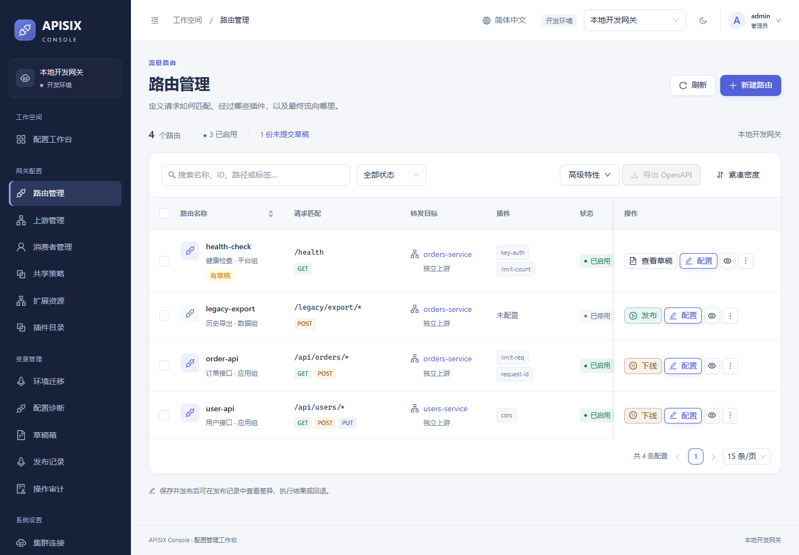

# 路由列表操作



## 单条路由

| 入口 | 行为 |
| --- | --- |
| 发布 / 下线 | 根据网关当前状态显示可执行动作。确认后仅变更 `status` 并发布，成功后原地刷新。取消会保留线上状态。 |
| 配置 / 查看草稿 | 配置打开路由编辑器，已有修改草稿会继续编辑。已有草稿时可以直接查看差异。历史草稿可直接在差异预览中发布或提交，删除草稿会显示「确认删除」。 |
| 查看配置（眼睛按钮） | 从当前集群读取最新网关配置，显示路由 ID、状态和脱敏 JSON。可与尚未发布的草稿分别核对。 |
| 更多 → 复制 | 使用网关配置打开新建表单，生成新的资源 ID，保留匹配条件、上游和插件引用。源路由中的脱敏凭据需要为新路由重新填写。 |
| 更多 → 删除 | 确认路由和集群后删除，完成时回读网关状态。 |

## 工具栏

- **插件模板配置**打开当前集群的共享插件配置。**数据编辑器**打开新路由的 JSON 编辑模式，可指定资源 ID，保存并直接发布。
- **导出 OpenAPI**只导出已选路由，可下载 JSON 或 YAML。两种文件包含 OpenAPI 3.0.3 的 `paths`，以及保存路由 ID、匹配条件、插件和上游引用的 `x-apisix-routes` 扩展。若多条路由匹配相同的路径与方法，标准操作会列出相关 ID，各条完整配置分别保留。上游或共享插件的定义可通过「环境迁移」连同依赖导出。
- **导入 OpenAPI**支持选择文件或粘贴 JSON / YAML。解析后默认在当前环境预览差异；也可选择其他已授权环境、映射 ID 和处理冲突。相同配置会跳过。点击「批量发布」后再次检查预览版本，并按依赖顺序写入目标集群。
- **批量删除**先列出名称和 ID。服务端检查集群权限、只读状态和每条路由的配置哈希，然后在一个事务中记录整批操作，发布时逐条执行并回读。遇到重复 ID、外部修改或已有活动草稿，整批停止。单次支持 1–50 条。

直接写入接口为 `POST /api/v1/clusters/{cluster}/config/apply`，批量删除为 `POST /api/v1/clusters/{cluster}/routes/batch-delete/apply`，迁移及 OpenAPI 导入为 `POST /api/v1/clusters/{cluster}/transfer/apply`。批量删除请求示例为 `{"routes":[{"id":"orders","base_hash":"从路由列表读取的 hash"}]}`。三个接口均校验会话、CSRF、编辑和发布权限。生产集群需在 `X-Confirm-Cluster` 头传入 URL 编码后的集群名称。成功受理返回 HTTP 201 及变更 ID，可通过 `GET /api/v1/changesets/{id}` 查询最终状态。将末尾的 `apply` 换为 `submit` 可只提交待发布变更。

### 文件如何映射为路由

1. 本控制台导出的文件以 `x-apisix-routes` 中的配置为准，保留原有 ID、状态和共享引用。已有敏感值以占位符导出。恢复至新资源前，需在文件中填入目标环境的 Secret 引用并准备好依赖。
2. 普通 OpenAPI 3.0 / 3.1 文档按 HTTP 方法和路径生成路由。可用的 `operationId` 作为 ID，否则按方法和路径生成稳定 ID。选择默认上游，或使用操作级 `x-apisix-upstream`、`x-apisix-upstream_id`、`x-apisix-service_id`。支持旧版 APISIX 的主机、插件、匹配条件、状态等扩展；未知的操作级 APISIX 扩展会报错。
3. 普通操作默认停用，显式的 APISIX 状态扩展会保留。正式启用前核对认证、参数校验和上游。OpenAPI 的 `security`、请求体和响应模型不会自动配置为网关插件。
4. 支持单个固定服务器的主机和路径前缀，`/orders/{id}` 匹配一个非空路径段。每份文件最多 2 MiB，最多 50 条路由；路径或操作上的 `$ref`、YAML 别名、多个或参数化服务器会提示修改文件。

标准操作和 APISIX 扩展字段可对照 [OpenAPI 3.0.3 规范](https://spec.openapis.org/oas/v3.0.3.html) 和 [Apache Dashboard 3.0.1 官方导入指南](https://github.com/apache/apisix-dashboard/blob/v3.0.1/docs/en/latest/IMPORT_OPENAPI_USER_GUIDE.md)。

## 复测

先按 [README 部署说明](../README.md#部署方式) 启动并初始化开发网关，再在项目根目录运行：

```sh
npm run test:web
npx playwright test tests/e2e/route-actions.spec.ts
```

| 浏览器场景 | 核验内容 |
| --- | --- |
| 路由操作列 | 查看实时配置，编辑、复制为独立路由；分别取消、下线、发布、删除。对照 `/status` 差异与网关的实际 200 / 404 响应。 |
| 高级特性及 OpenAPI | 打开模板列表；用 JSON 编辑器创建并发布；下载并解析两种格式，重新导入同配置时跳过。由标准文档生成带参数路由，验证单段路径命中、多段不命中。 |
| 批量删除 | 重复 ID、过期基线、已有活动草稿整批拒绝；正常批次确认后验证两条路由均下线。 |
| 权限及响应式 | 真实只读成员可查看和导出，写入菜单禁用，直接调用批量删除接口返回 403；切换英文并检查 390px 窄屏。 |
| 环境隔离 | 从已选中路由的开发环境切到预发，核对选区已清空。把本地连接临时设为只读，即使管理员也无法提交删除，既有业务请求正常。 |
| 并发及脱敏 | 从打开确认框到保存之间模拟外部更新，校验返回 409；刷新后成功。详情和导出隐藏认证头，发布状态变更后认证头保留原值。 |

测试仅对配套开发网关创建临时路由和成员账号。测试结束后清理临时网关资源、未提交草稿和账号，Dashboard 保留已执行的发布与审计记录。

**此前版本验收记录。** APISIX 3.19.0 上通过 58 项浏览器测试，其中 6 项专门覆盖路由列表操作。前端单元测试 84 项、真实网关高级路由集成 19 项全部通过；Go 竞态测试、`go vet`、TypeScript 检查、前端生产构建和格式检查通过。通过浏览器导出的两条演示路由在 JSON 与 YAML 中解析结果相同，两份文件均通过 OpenAPI 3.0.3 官方 Schema 校验。结束时本轮临时路由、活动草稿和成员账号各为 0。

## 直接发布的集成测试

以下命令创建仅使用 Docker 内网的 PostgreSQL、Dashboard、APISIX 和 nginx，用于验证 HTTP 与 TCP 路由。测试覆盖 12 类可写资源的创建、修改、删除、权限移交、生产集群确认、历史草稿兼容及回退。

```sh
docker compose -p apisix-dashboard-direct-test -f tests/stream/compose.yaml -f tests/stream/direct.yaml up --build --abort-on-container-exit --exit-code-from direct-test direct-test
docker compose -p apisix-dashboard-direct-test -f tests/stream/compose.yaml -f tests/stream/direct.yaml down -v
```

| 直接发布实测场景 | 核验结果 |
| --- | --- |
| 12 类资源 | HTTP 路由、Stream 路由、上游、服务、消费者、消费者组、独立凭据、共享插件配置、全局规则、插件元数据、Proto、Secret 管理器均完成新增、脱敏预览、修改及删除。每次操作检查发布详情与网关回读。 |
| 真实请求 | HTTP 路由验证无凭据返回 401、有效凭据返回 200，并核对全局插件添加的响应头。TCP 9100 经 APISIX 转发到 nginx 并返回 200。 |
| 权限与异常 | 生产名称缺失或不匹配、集群 ID 不一致、过期配置基线、缺少引用、只读资源、编辑员越权发布分别被拒绝。校验失败后线上基线保持原值。 |
| 草稿兼容与回退 | 编辑员直接提交后网关继续使用旧配置，发布人确认后生效。回退后真实请求恢复。历史草稿可直接发布，错误修订号被拒绝。 |

本次最终版本在本地 Docker APISIX 3.19.0 上通过 30 组隔离网关检查。浏览器通过 59 项用例，其中 8 项覆盖直接提交与回退、路由列表操作、导入与跨环境迁移，另外 51 项覆盖原有编辑器、认证插件、权限、语言和工作台。前端 84 项单元测试、TypeScript 类型检查、生产构建、代码格式检查，以及后端 Go 竞态测试和静态检查均通过。
